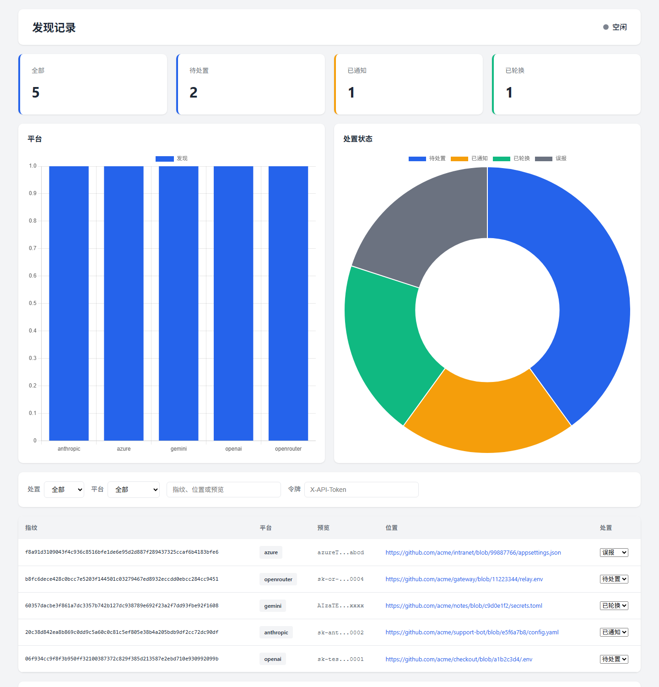

# AI API Key Scanner

在你有权检查的 GitHub 组织或仓库里查找泄露的 API 密钥。远程搜索没有 `--target-org` 或 `--target-repo` 不会发出。交给外部代理的文件是脱敏记录，不是一套能直接使用的密钥。


唯一入口是 `main_v2.2.py`。使用边界见 [AUTHORIZED_USE.md](AUTHORIZED_USE.md)。



## What does this do?

在限定的组织或仓库里搜索已提交的密钥材料，滤掉明显的测试值和低熵字符串，再写入本地 SQLite。终端界面会跳过已经查过的记录。

`benchmark.py` 只比较合成数据的 SQLite 插入。它不搜索 GitHub，也不访问模型厂商。旧的「430 倍」不是端到端扫描结果。

## Supported platforms

**Major AI platforms:**
- OpenAI (GPT-4, GPT-5)
- Anthropic (Claude)
- Google (Gemini)
- Azure OpenAI
- xAI (Grok)
- Meta (Llama API)

**API aggregators:**
- OpenRouter
- Portkey
- LiteLLM
- Cloudflare Workers AI

**Cloud provider AI services:**
- AWS Bedrock
- Google Vertex AI
- Alibaba Cloud
- Volcano Engine
- Tencent Cloud
- Baidu Qianfan

**Regional providers:**
- DeepSeek, Moonshot, Zhipu (Chinese platforms)
- Groq, Mistral, Cohere (International)
- Plus 20+ more platforms

Full list: OpenAI, Anthropic, Google Gemini, Azure, xAI, Meta Llama, OpenRouter, Portkey, LiteLLM, Cloudflare AI, AWS Bedrock, Vertex AI, Alibaba Cloud, Volcano Engine, Tencent Hunyuan, Baidu Qianfan, DeepSeek, Moonshot, Zhipu, Yi AI, StepFun, iFlytek, HuggingFace, Groq, Cohere, Mistral, Together AI, Replicate, Perplexity, Fireworks, AI21, Writer, Forefront, Modal, RunPod, Baseten, and generic services like AWS, GitHub tokens, Stripe, etc.

## Quick start

**Requirements:**
- Python 3.10+
- GitHub personal access token (free, takes 2 minutes to get)

**Install:**

```bash
git clone https://github.com/Coff0xc/Github-API-scan.git
cd Github-API-scan
pip install -r requirements.txt
```

**Configure:**

Create `config_local.py` (or copy `.env.example` to `.env` for Docker):

```python
GITHUB_TOKENS = [
    "ghp_your_token_here",  # Get from github.com/settings/tokens
]

# Optional proxy
PROXY_URL = ""  # e.g., "http://127.0.0.1:7890"
```

To get a GitHub token:
1. Go to https://github.com/settings/tokens
2. Click "Generate new token (classic)"
3. Check `public_repo` 
4. Copy the token

**Run:**

```bash
python main_v2.2.py --authorized --target-org your-org
```

Remote search does not start without `--target-org` or `--target-repo`. Set `DB_ENCRYPTION_KEY` first, or pass `--allow-plaintext-db`.

> `--authorized` confirms the use boundary in AUTHORIZED_USE.md. `SCANNER_AUTHORIZED=1` does the same for CI. Docker Compose does not set that variable for you. Without either one, an interactive terminal asks for `y`.

**Recommended security environment variables** (copy from `.env.example`):

```bash
export DB_ENCRYPTION_KEY=<随机长密码>   # 结果库静态加密（api_key 不落明文）
export DASHBOARD_TOKEN=<随机长密码>     # Web 面板访问令牌（未设置时功能受限）
```

## Usage

Basic commands:

```bash
# Remote scan. Refuses to start unless the search is limited to an org or repo.
python main_v2.2.py --authorized --target-org your-org

# View stats
python main_v2.2.py --stats

# Export is masked unless you pass --reveal
python main_v2.2.py --export results.txt --status valid

# Export to CSV
python main_v2.2.py --export-csv results.csv --status valid

# Encrypted export (recommended when you need the raw key)
python main_v2.2.py --export-encrypted secure.bin
```

Set `DB_ENCRYPTION_KEY` before a scan writes anything. `--allow-plaintext-db` is the explicit override.

Advanced options:

```bash
# Disable cache (slower but uses less memory)
python main_v2.2.py --authorized --target-org your-org --no-cache

# Public sources are not limited by org: or repo:. They stay off unless you opt in.
python main_v2.2.py --authorized --target-org your-org --all-sources --allow-public-sources

# Use custom database
python main_v2.2.py --db custom.db --stats
```

**授权渗透 / 自有资产审计（authorized engagement）：**

```bash
# 本地仓库审计：当前文件 + 全量 Git 历史（已删除的密钥也能找到）
python main_v2.2.py --authorized --scan-local D:\repos\target

# 扫描 + 直接产出威胁报告（存活凭据 = 威胁点，附处置建议）
python main_v2.2.py --authorized --scan-local D:\repos\target --report threat.md

# 远程 GitHub 搜索限定到授权范围（所有查询自动追加 org:/repo: 限定符）
python main_v2.2.py --authorized --target-org customer-org
python main_v2.2.py --authorized --target-repo customer-org/api-server

# 基于已有结果库单独出报告（默认脱敏，--reveal-report 输出完整 Key）
python main_v2.2.py --authorized --report threat.md --reveal-report
```

详见 [docs/LOCAL_SCANNING.md](docs/LOCAL_SCANNING.md)。

## How it works

1. **Scan**: GitHub 搜索只在 `--target-org` 或 `--target-repo` 之内发出
2. **Filter**: 用熵和黑名单去掉测试值、占位符和明显垃圾
3. **Store**: 写入 SQLite。设置 `DB_ENCRYPTION_KEY` 后，密钥列是 Fernet 密文
4. **Disclose**: `--findings-json` 和面板上的发现列表只含指纹、位置和脱敏预览

扫描进程里的验证请求打到密钥声明的服务。对没有授权的资产做这件事，不在 [AUTHORIZED_USE.md](AUTHORIZED_USE.md) 允许的范围内。

## Security hardening (v3.0.1)

| Mechanism | How to enable | Effect |
|---|---|---|
| 使用边界确认 | `--authorized` / `SCANNER_AUTHORIZED=1` | 启动前强制确认仅授权使用。Docker 不再默认写成 1 |
| 远程范围 | `--target-org` / `--target-repo` | 没有范围时 GitHub 搜索不会发出 |
| 公开源 | `--allow-public-sources` | Gist、Pastebin、GitLab、Searchcode、Events 默认关闭 |
| 写库加密 | `DB_ENCRYPTION_KEY` | 未设置时扫描拒绝写入，除非 `--allow-plaintext-db` |
| 导出脱敏 | `--export` / `--reveal` | 文本和 CSV 默认脱敏 |
| 代理管道 | `--findings-json` | 给 Grok Bot / Muse 的 JSON 不含明文 Key。说明见 [docs/AGENT_PIPELINE.md](docs/AGENT_PIPELINE.md) |
| 结果库静态加密 | `DB_ENCRYPTION_KEY` 环境变量 | `api_key` 列存 Fernet 密文，去重走 SHA-256 指纹 |
| Web 面板鉴权 | `DASHBOARD_TOKEN` 环境变量 | Key 默认脱敏；reveal/导出/推送需令牌，认证失败限速 |
| 加密导出 | `GET /api/export`（需令牌） | 返回 Fernet 加密 JSON；`mask=1` 可导脱敏版 |
| config.yaml 生效 | 编辑 `config.yaml` | 熵阈值/并发/黑名单/批量写入等参数现由代码实际读取 |

`config.yaml` 现在是真实生效的外部配置（优先级：内置默认 < config.yaml <
config_local.py < 命令行参数）。

## Configuration

Edit `config.yaml` to tune performance:

```yaml
# High-performance setup (16GB+ RAM)
validator:
  max_concurrency: 200
  num_workers: 4

database:
  batch_size: 100
  flush_interval: 2.0

# Low-resource setup (8GB RAM)
validator:
  max_concurrency: 50
  num_workers: 1

database:
  batch_size: 20
  flush_interval: 10.0
```

## Project structure

```
├── main_v2.2.py           # Only entry point
├── scanner.py             # GitHub scanning (requires an org or repo)
├── validator_optimized.py # Validation path used by the entry point
├── validator.py           # Shared validation primitives
├── findings_feed.py       # Redacted findings for an external agent
├── database.py            # SQLite storage
├── web_dashboard.py       # Local dashboard
├── config.py              # Platform config
└── config.yaml            # User config
```

## Version history

**v3.0 (2026-07-24):**
- Added 20+ new platforms (OpenRouter, AWS Bedrock, xAI Grok, etc.)
- Updated GitHub search syntax (removed deprecated `NOT` operator)
- All comments and docs now in English
- 93 optimized search queries (up from 70)

**v2.2 (2026-01-12):**
- Smart caching system (30-50% cache hit rate)
- Batch validation (40-60% fewer requests)
- Domain health tracking

**v2.1 (2026-01-11):**
- HTTP connection pooling
- Smart retry mechanism
- Performance monitoring

**v2.0 (2026-01-11):**
- Async database writes (`benchmark.py` measures this micro-benchmark only)
- Queue expansion (1000 → 10000)
- Encrypted export

## Legal stuff

This tool is for **authorized security testing only**. See [AUTHORIZED_USE.md](AUTHORIZED_USE.md) for the full boundary policy (enforced at startup).

Don't use it to:
- Scan repos you don't have permission to test
- Exploit keys you find
- Do anything illegal

If you find leaked keys:
1. Report them to the repo owner
2. Don't use them
3. Don't share them

作者不对误用负责。范围和授权对不上时，不要运行扫描。

## Security recommendations

**For researchers:**
- Always get authorization first
- Use encrypted export for findings
- Report through proper channels
- Rate limit your scans

**For developers who got breached:**

If this tool found your key:

```bash
# 1. Revoke the key NOW (don't wait)

# 2. Remove from git history
git filter-repo --path path/to/file --invert-paths

# 3. Add to .gitignore
echo ".env*" >> .gitignore
echo "config_local.py" >> .gitignore

# 4. Use environment variables
export OPENAI_API_KEY="sk-..."

# 5. Install pre-commit hooks
pip install pre-commit gitleaks
pre-commit install
```

## Documentation

**根目录**
- [AUTHORIZED_USE.md](AUTHORIZED_USE.md) - **使用边界声明（必读）**

**docs/**
- [QUICKSTART.md](docs/QUICKSTART.md) - 从安装到第一次限定范围的扫描
- [USAGE_GUIDE.md](docs/USAGE_GUIDE.md) - 完整使用说明
- [LOCAL_SCANNING.md](docs/LOCAL_SCANNING.md) - 本地仓库审计和威胁报告
- [AGENT_PIPELINE.md](docs/AGENT_PIPELINE.md) - 给 Grok Bot / Muse 的脱敏发现
- [AI_ASSISTED_ANALYSIS.md](docs/AI_ASSISTED_ANALYSIS.md) - 可选的假阳性过滤
- [DOCKER_GUIDE.md](docs/DOCKER_GUIDE.md) - Docker 部署
- [WEB_DASHBOARD_GUIDE.md](docs/WEB_DASHBOARD_GUIDE.md) - Web 面板
- [NOTIFY_README.md](docs/NOTIFY_README.md) - 通知渠道配置
- [MIGRATION.md](docs/MIGRATION.md) - 旧入口已经删除
- [SECURITY.md](SECURITY.md) - 报告本仓库缺陷时不要贴密钥

## Contributing

Found a bug? Want to add a platform? PRs welcome.

```bash
# Fork and clone
git clone https://github.com/Coff0xc/Github-API-scan.git

# Create branch
git checkout -b feature/new-platform

# Make changes and test
python test_boundary_fixes.py
python test_findings_feed.py

# Submit PR
git push origin feature/new-platform
```

## FAQ

**Q: Is this legal?**  
A: Yes, if you have authorization. No, if you don't.

**Q: Why do I need a GitHub token?**  
A: 搜索接口对未认证请求限额很低。令牌放在 `GITHUB_TOKENS` 或 `config_local.py`，不要写进仓库。

**Q: Can I scan any public repo?**  
A: 不能。远程搜索必须指定组织或 `owner/name`。范围应是你拥有或已获授权的资产。

**Q: What leaves the machine?**  
A: `--findings-json` 和 `GET /api/findings` 只有指纹、位置、脱敏预览和处置状态。明文导出需要 `--reveal`。

**Q: Why are some platforms missing?**  
A: 没有单独识别规则的服务会落到通用匹配。缺规则可以提 PR，不要附上真实密钥。

## License

MIT License. See [LICENSE](LICENSE) file.

## Credits

Built by security researchers, for security researchers.

Uses: aiohttp, Rich, PyGithub, loguru, and other open source libraries.

---

**Use responsibly.** Don't be the reason GitHub adds more rate limits.
