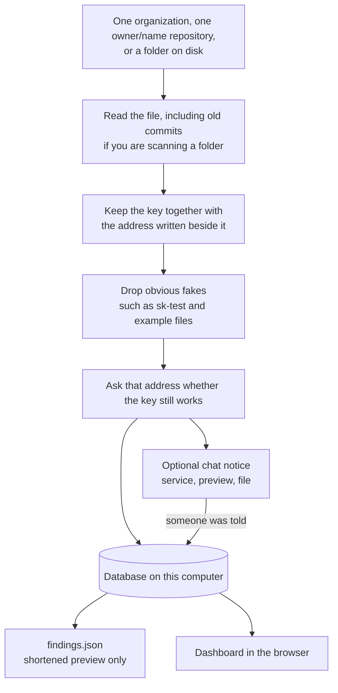
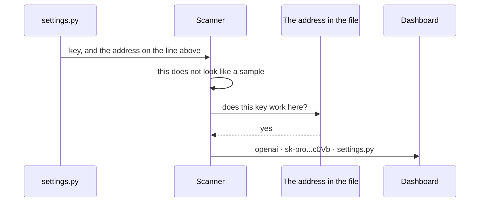
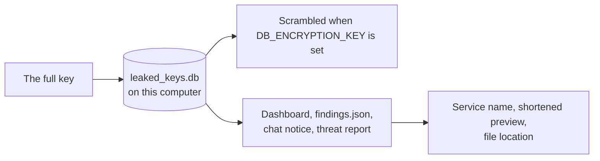
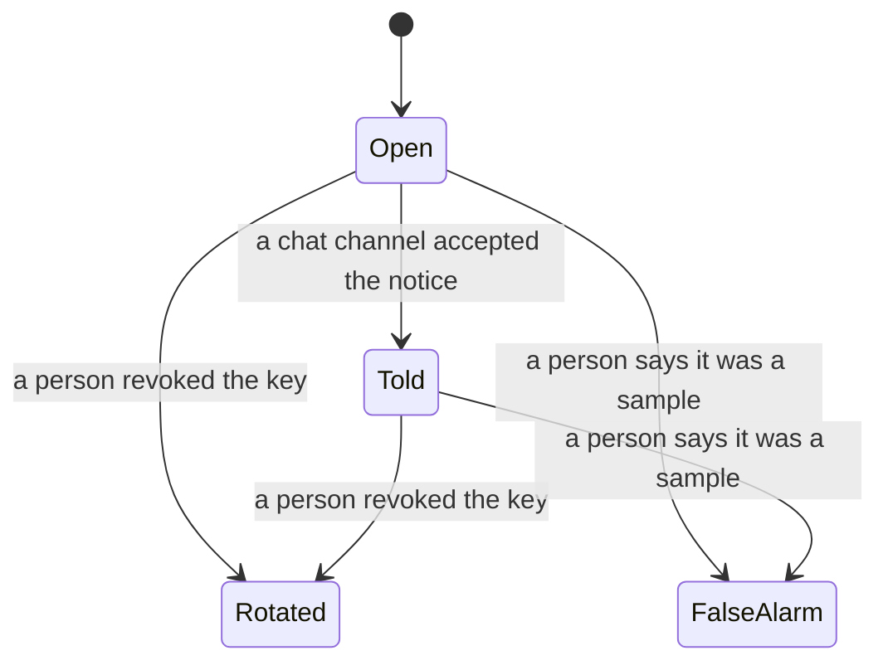
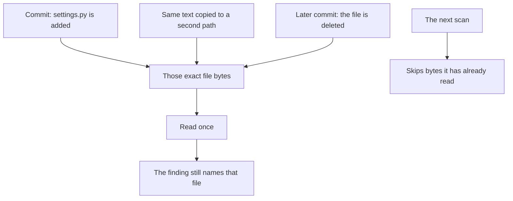

<h1 align="center">AI API Key Scanner</h1>

<p align="center">
Someone committed an API key. This tool finds it, keeps the website address written next to it, checks that pair only on a project you are allowed to test, and gives you a short record you can show the owner.
<br><br>
The key itself stays on the machine that ran the scan.
</p>

<p align="center">
  
  
  
</p>

<p align="center">
  
</p>

<p align="center">
  <sub>The page you get on this computer, in English. The company name <code>acme-labs</code> is made up. The previews are shortened on purpose. Nothing on this page is a usable key.</sub>
</p>

| If you own the code | If you run the scan |
| --- | --- |
| Open `http://127.0.0.1:5000` after someone else has scanned. | Run `python main_v2.2.py` and name the organization or the folder. |
| Each row is one place a key showed up: the service, a shortened preview, and the file. | When it finishes, the same rows are in `findings.json`. |
| Tell the owner those three things. Do not paste the real key into chat. | The real key stays in the local database, scrambled if you set a passphrase. |
| After the key is revoked, mark the row **Rotated**. If it was only an example, mark it **False alarm**. | The header of the page switches between **EN** and **中文**. |

## A scan, from the top

You point it at one place. It does not go looking across all of GitHub.



A remote search will not even start until you pass `--target-org your-org` or `--target-repo owner/name`. The repository form has to be `owner/name`, and it wins if you pass both. Paste sites, Gist, and similar public dumps stay off. They cannot be limited to one organization. Turn them on only when the written permission covers them, with `--allow-public-sources`.

## One file, drawn out

Picture `app/settings.py` inside an organization you are allowed to audit:

```text
OPENAI_BASE_URL=https://api.internal-relay.invalid/v1
sk-proj-Qw9Rt8Yu7Ip6Lk5Jh4Gf3Ds2Az1Xc0Vb
```

The two lines belong together. The key is not checked against OpenAI's own site, because the file says to use a relay. A relay is just another server that speaks the same API.



What a person sees is `sk-pro...c0Vb`: the first six characters, three dots, and the last four. The full key is not on the page.

The row also gets an id, called the fingerprint. It is the SHA-256 of the key, 64 hex characters. You use that id when you mark the row rotated. It is not the key, and it cannot be turned back into the key.

If the same text matches a short pattern and a longer one, only the longer one is kept. Otherwise the tail of an OpenAI key would show up again as a second, unrelated service.

## What leaves the machine, and what stays



`findings.json` and the page `GET /api/findings` are the same list. Asking either of them to reveal the key does nothing. Both files, and `dispositions.json`, are gitignored. Do not commit them.

| What you call it | Field in the file | What it actually is |
| --- | --- | --- |
| Id | `fingerprint` | SHA-256 of the key. Use this to update the row. |
| Service | `platform` | `openai`, `anthropic`, `azure`, `openrouter`, and so on. A private relay is stored as `relay`. |
| Preview | `preview` | First 6 characters, `...`, last 4. |
| Repository | `repo` | `owner/name`. A Gist is `gist:user`. |
| File | `path` | Path inside that repository. |
| Commit or branch | `commit` | Taken from the link. A branch name lands here when the link uses a branch. |
| Link | `location` | The original URL, or a `local://` path. |
| What you did about it | `disposition` | `open`, `notified`, `rotated`, or `false_positive`. |
| When | `found_time` | When the row was stored. |

```json
{
  "schema": "findings.v1",
  "generated_at": "2026-11-10T08:00:00Z",
  "findings": [
    {
      "fingerprint": "06f934c99f8f30950ff32100387372c829f385d213587e2ebd710e930992099b",
      "platform": "openai",
      "preview": "sk-pro...k9Q2",
      "repo": "acme-labs/billing-api",
      "path": ".env",
      "commit": "4c1e9a2",
      "location": "https://github.com/acme-labs/billing-api/blob/4c1e9a2/.env",
      "disposition": "open",
      "found_time": "2026-11-10T07:40:00"
    }
  ]
}
```

That id and that preview are examples. They are not a key.

The check itself has four answers:

| Answer | Meaning |
| --- | --- |
| `pending` | Not checked yet. |
| `valid` | The address accepted the key. |
| `invalid` | The address rejected it. |
| `quota_exceeded` | The key is real, and the account is out of credit or out of requests. Still treat it as live. |

The scanner does not call private-network addresses, link-local addresses, or reserved and multicast addresses. If a hostname's DNS answers include any of those, the call is refused. `localhost`, `127.0.0.1`, and `::1` still work, so you can point a test at a relay running on the same machine.

## What happens to a row



| On the page | In the file | Who sets it |
| --- | --- | --- |
| Open | `open` | The scan, when the row is new. |
| Notified | `notified` | The tool, after Discord, Slack, or another channel accepts the message. |
| Rotated | `rotated` | A person, after the key is actually revoked. The tool cannot see the vendor's website. |
| False alarm | `false_positive` | A person, when the text was a sample or not a secret. |

```bash
python main_v2.2.py --set-disposition <64-hex-id> rotated
python main_v2.2.py --apply-dispositions dispositions.json
```

A batch file looks like this. Extra fields are ignored. The id still has to be 64 hex characters. A bare list, or an object whose list is named `findings`, is also accepted.

```json
{
  "updates": [
    {"fingerprint": "<64 hex>", "disposition": "rotated"}
  ]
}
```

## Old commits still count

Deleting a file today does not delete the commit that added it. A folder scan reads Git history, so that older copy can still show up.



The tool asks Git for every file object, then reads each unique one once. Two paths with the same bytes are one read. The next run skips objects it has already recorded. Commit messages are read on their own, so a key pasted into a message is not mixed into whichever file happened to be nearby.

`--no-git-history` stays on the files sitting in the folder now. Files larger than 500 KB, and files that look binary, are skipped. Change the size in `config.yaml` if you need to.

## Install and the three secrets

Python 3.10 or newer.

```bash
git clone https://github.com/Coff0xc/Github-API-scan.git
cd Github-API-scan
pip install -r requirements.txt
```

On Windows, if a package tries to install `uvloop`, skip it. The scanner does not need it.

Three values matter. None of them belong in git. `config_local.py` is already ignored.

| Name | Plain job |
| --- | --- |
| `GITHUB_TOKENS` | Lets the scan search the organization you named. A classic token needs read access to those repositories. Several tokens, separated by commas, share the rate limit. |
| `DB_ENCRYPTION_KEY` | Passphrase for the database. Without it, a scan refuses to save. `--allow-plaintext-db` is the explicit override. |
| `DASHBOARD_TOKEN` | Password for changing a row in the browser, and for export. Reading the masked list does not need it. |

bash:

```bash
export GITHUB_TOKENS="ghp_your_token_here"
export DB_ENCRYPTION_KEY="a-long-random-passphrase"
export DASHBOARD_TOKEN="another-random-passphrase"
```

PowerShell:

```powershell
$env:GITHUB_TOKENS = "ghp_your_token_here"
$env:DB_ENCRYPTION_KEY = "a-long-random-passphrase"
$env:DASHBOARD_TOKEN = "another-random-passphrase"
```

Or copy `config_local.py.example` to `config_local.py` and set `GITHUB_TOKENS` there.

How the database lock works, if you need the exact construction: the column is Fernet ciphertext starting with `enc:v1:`. The key is PBKDF2-HMAC-SHA256 of your passphrase, salt `github-api-scan/key-vault/v1`, 200,000 rounds. Losing the passphrase means old rows cannot be read. The fingerprint does not change when you turn encryption on, because it is a hash of the key, not of the ciphertext.

Settings are layered. Later wins: built-in defaults, then `config.yaml`, then `config_local.py`, then command-line flags.

Before a scan, the program wants a yes. `--authorized` is that yes, after you have read [AUTHORIZED_USE.md](AUTHORIZED_USE.md). In CI, set `SCANNER_AUTHORIZED=1`. In a terminal, with neither, it asks you to type `y`. A script with neither stops.

Docker Compose does not pick an organization for you, and it does not set that yes. The scanner service's command is `python main_v2.2.py`, so a container started from the file as written will stop at the scope check. Override the command with `--authorized` and a target, and set `DB_ENCRYPTION_KEY`. The dashboard container publishes `127.0.0.1:5000` on the host. Inside the container it listens on `0.0.0.0`, which is acceptable only because the published port is still this machine. Opening that port on a LAN means you need a strong dashboard token. See [docs/DOCKER_GUIDE.md](docs/DOCKER_GUIDE.md).

## Run it

```bash
python main_v2.2.py --authorized --target-org your-org
python main_v2.2.py --authorized --target-repo owner/name
python main_v2.2.py --authorized --scan-local D:\repos\target
```

Each of those writes `findings.json` in the working directory. Another path: `--findings-json reports/findings.json`. If you pass only that flag and no target, it exports the database you already have and exits.

While the scan runs, the terminal title is **AI API Key Scanner**. The table under the counters is **发现记录**: service, shortened preview, status, and place. It is the same idea as the screenshot, in the terminal. There is no balance column.

Set `AI_FILTER_ENABLED=1` if you want a model to drop rows that look like examples. It is off unless you turn it on. See [docs/AI_ASSISTED_ANALYSIS.md](docs/AI_ASSISTED_ANALYSIS.md).

## The page in the screenshot

```bash
python web_dashboard.py
```

Open `http://127.0.0.1:5000`. It binds to this machine only, unless you set `DASHBOARD_HOST`. Any other address puts the page on the network.

The counts are all rows, open, notified, and rotated. Under them, one chart is services and one is status. You can filter, and you can search the id, the preview, or the place. The id in the table is shortened. Hover a row for all 64 characters. That full value is what you send when you change the status.

The token box keeps `DASHBOARD_TOKEN` in the browser tab and sends it only as the header `X-API-Token`. It is not accepted in the URL, so it does not land in access logs. The reply is `ok`, the id, and the new status. It does not send back a key, even if the request also contained one.

| Request | Needs the token? | What you get |
| --- | --- | --- |
| `GET /` | no | The page in the screenshot. |
| `GET /api/findings` | no | The masked list. A reveal flag is ignored. |
| `GET /api/stats` | no | Counts. |
| `POST /api/findings/disposition` | yes | Updates one row by its id. |
| `GET /api/keys` | only if you ask to reveal | Masked rows, unless reveal is allowed. |
| `GET /api/export` | yes, and the token must be configured | An encrypted file. `mask=1` returns masked JSON. |
| `POST /api/stats/update` | yes | Progress the scanner pushes into the page. |

No header: HTTP 401. Token not configured: HTTP 403, and export is off. A wrong token is HTTP 401. After 10 failures from the same address within 60 seconds, that address gets HTTP 429. The limit uses the connection's own address, not `X-Forwarded-For`.

There is no export button on the page. Export exists for a review you are allowed to run. The file is Fernet, from `EXPORT_KEY` or, if that is unset, from `DASHBOARD_TOKEN`. Salt `github-api-scan/export/v1`, 200,000 rounds. `DB_PATH` picks the database file for both the scanner and the page.

The page loads its charts from a CDN. If the charts stay empty and the table is fine, the CDN was blocked.

## Notices, the report, and helpers

If you configure a channel, a live key or a quota hit can send four lines: the service, the shortened preview, the place, and a reminder that the message has no full key and no balance. When the channel accepts it, the row becomes notified. With no channel, nothing is sent and the row stays open. The scanner does not write a desktop file of raw keys.

```text
Discord          DISCORD_WEBHOOK
Slack            SLACK_WEBHOOK
Telegram         TELEGRAM_BOT_TOKEN and TELEGRAM_CHAT_ID
Feishu           FEISHU_WEBHOOK
DingTalk         DINGTALK_WEBHOOK, optional DINGTALK_SECRET
ServerChan       SERVERCHAN_KEY
Bark             BARK_DEVICE_KEY
```

Copy `notify_config.example.yaml` when you want a file, or set `NOTIFY_CONFIG` to another path. Quiet hours and a rate limit still exist in that file. A normal scan notice is not treated as an emergency, so quiet hours can hold it. See [docs/NOTIFY_README.md](docs/NOTIFY_README.md).

A Markdown report for the same review:

```bash
python main_v2.2.py --authorized --report threat.md
```

It lists keys that came back valid or out of quota, newest first. Each line has the service, the status, the shortened preview, the place, and the time. Model name and requests-per-minute show up only when the check actually returned them. They do not change the order. `--reveal-report` prints full keys into that file. Keep it out of git.

Grok Bot and Muse can read `findings.json` or `GET /api/findings`, group rows by repository, and write statuses back after a person decides. They do not start a scan. They do not receive the raw key, the database passphrase, or the dashboard token. See [docs/AGENT_PIPELINE.md](docs/AGENT_PIPELINE.md).

## Everyday commands

```bash
python main_v2.2.py --stats
python main_v2.2.py --findings-json findings.json
python main_v2.2.py --export results.txt --status valid
python main_v2.2.py --export-csv results.csv --status valid
python main_v2.2.py --export-encrypted secure.bin
python main_v2.2.py --authorized --report threat.md
```

Text and CSV are shortened. `--reveal` writes full keys into an export. Do not commit that file.

<details>
<summary>Every flag</summary>

| Flag | What it does |
| --- | --- |
| `--authorized` | Confirm you have read the use rules for this run. |
| `--target-org ORG` | Search one GitHub organization. |
| `--target-repo OWNER/REPO` | Search one repository. Wins over `--target-org`. |
| `--scan-local DIR` | Scan a folder and its Git history. |
| `--no-git-history` | With `--scan-local`, ignore older commits. |
| `--findings-json FILE` | Write the masked list. |
| `--set-disposition ID STATUS` | Set one row to `open`, `notified`, `rotated`, or `false_positive`. |
| `--apply-dispositions FILE` | Apply a list of those updates. |
| `--stats` | Print database counts. |
| `--export FILE` | Masked text. `--status valid` or `quota_exceeded` filters it. |
| `--export-csv FILE` | Masked CSV. |
| `--export-encrypted FILE` | Encrypted export. The key file is written beside it. |
| `--decrypt FILE` | Decrypt that export. |
| `--key-file KEY` | Key file for `--decrypt`. |
| `--reveal` | Put full keys in a text or CSV export. |
| `--report FILE` | Write the Markdown report. |
| `--reveal-report` | Put full keys in that report. |
| `--db FILE` | Database path. Default `leaked_keys.db`. |
| `--proxy URL` | HTTP proxy. |
| `--allow-plaintext-db` | Allow saving without `DB_ENCRYPTION_KEY`. |
| `--allow-public-sources` | Allow Gist, Pastebin, GitLab, Searchcode, and Events. |
| `--gist` `--pastebin` `--gitlab` `--searchcode` `--realtime` | Turn one of those on. Still needs `--allow-public-sources`. |
| `--all-sources` | Turn all of them on. Still needs `--allow-public-sources`. |
| `--pastebin-key KEY` | Pastebin Pro key, only if Pastebin is enabled. |
| `--no-cache` | Do not reuse earlier check results for this run. |
| `--no-monitor` | Skip the performance monitor. |
| `--no-dynamic-queue` | Keep the queue size fixed. |

</details>

## Which services it recognizes

The shapes it knows include OpenAI (`sk-proj-`, `sk-svcacct-`), Anthropic (`sk-ant-api03-` and the versions around it), Gemini (`AIza`), xAI (`xai-`), Groq (`gsk_`), Hugging Face (`hf_`), OpenRouter (`sk-or-v1-`), DeepSeek, Moonshot, Zhipu, and Portkey. Also the cloud prefixes used by Bedrock, Aliyun, Volcengine, Tencent Hunyuan, Baidu Qianfan, and Vertex.

Azure is special. A 32-character hex string is too common to trust by itself, so Azure is accepted when the text around the key names an Azure OpenAI endpoint. Cloudflare, Together, and a few generic patterns are wide for the same reason. A wide match that is only the tail of a longer key is dropped.

Also in the set: Meta Llama, LiteLLM, Mistral, Cohere, MiniMax, Baichuan, Replicate, Perplexity, Fireworks, plus a generic pass for GitHub tokens, AWS keys, and Stripe keys. The patterns live in `config.py`.

Knowing a shape means the scanner can look for it and knows where to check it. It does not mean you may check a key from a repository you were not allowed to open.

## Numbers in config.yaml

These are the values shipped in the file. The code reads them. Do not put tokens in this file.

| What you are tuning | Key | Shipped | Effect |
| --- | --- | --- | --- |
| How random a string must look before it counts | `scanner.entropy_threshold` | `3.8` | Duller strings are treated as samples. |
| Largest file to read | `scanner.max_file_size_kb` | `500` | Bigger files are skipped. |
| Files fetched at once | `scanner.async_download_concurrency` | `60` | Remote scan only. |
| Lines kept around a hit | `scanner.context_window` | `10` | So the address beside the key is still visible. |
| Checks in flight | `validator.max_concurrency` | `100` | |
| Give up after | `validator.request_timeout` | `15` seconds | |
| Worker threads | `validator.num_workers` | `2` | |
| Rows per write | `database.batch_size` | `50` | |
| Seconds between writes | `database.flush_interval` | `5.0` | |
| Failures before a host is paused | `circuit_breaker.failure_threshold` | `5` | Stops hammering a dead server. |
| Pause length | `circuit_breaker.recovery_timeout` | `60` seconds | |
| Tries while waking a host back up | `circuit_breaker.half_open_requests` | `3` | |

Official API hostnames are not paused by that breaker, so a pile of bad keys does not block the vendor's real site. A separate list in the same file ignores example hosts when pairing an address. That list is not the private-network check. Loopback is still allowed on purpose.

## Where you may point it

Your own projects. A project whose owner has given you written permission. Your own keys, in an emergency where you can still revoke them. A lab you control.

The program will not search the whole of GitHub, will not turn on public paste sites by itself, and will not save a database until encryption is set or you explicitly accept plaintext. What to do after a find is in [AUTHORIZED_USE.md](AUTHORIZED_USE.md). How to report a bug here without pasting keys, database files, or tokens is in [SECURITY.md](SECURITY.md).

## Where the code for each step lives

```text
main_v2.2.py            the only command
use_boundary.py         the yes-prompt and the scope check
scanner.py              GitHub search, and pairing a key with its address
local_scanner.py        a folder, and each unique Git file once
validator_optimized.py  the check the command actually runs
validator.py            shared types, the breaker, and the older check
findings_feed.py        findings.json and the four-line notice
database.py             SQLite, already-read files, status by id
key_vault.py            scrambling the key, and the fingerprint
threat_report.py        the Markdown report
web_dashboard.py        the page in the screenshot
notifier_v2.py          Discord, Slack, and the other channels
notify_integration.py   when a notice is sent, and when a row becomes notified
config.py               service patterns and default addresses
config.yaml             the numbers in the table above
```

## More to read

- [AUTHORIZED_USE.md](AUTHORIZED_USE.md)
- [SECURITY.md](SECURITY.md)
- [docs/QUICKSTART.md](docs/QUICKSTART.md)
- [docs/USAGE_GUIDE.md](docs/USAGE_GUIDE.md)
- [docs/LOCAL_SCANNING.md](docs/LOCAL_SCANNING.md)
- [docs/AGENT_PIPELINE.md](docs/AGENT_PIPELINE.md)
- [docs/DOCKER_GUIDE.md](docs/DOCKER_GUIDE.md)
- [docs/NOTIFY_README.md](docs/NOTIFY_README.md)
- [docs/WEB_DASHBOARD_GUIDE.md](docs/WEB_DASHBOARD_GUIDE.md)
- [docs/AI_ASSISTED_ANALYSIS.md](docs/AI_ASSISTED_ANALYSIS.md)

## License

MIT. See [LICENSE](LICENSE).
