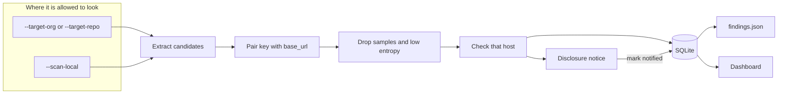
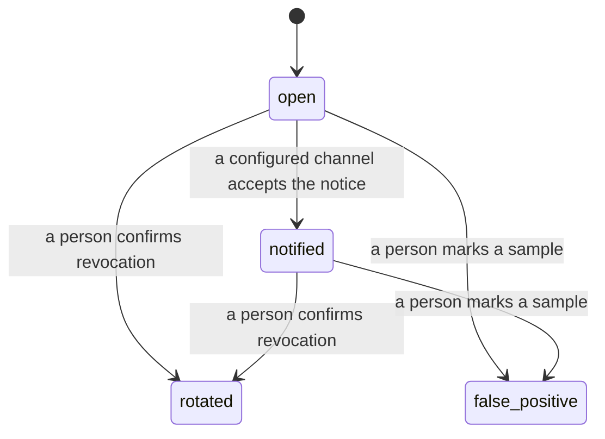

# AI API Key Scanner

An authorized audit finds an AI API key, keeps the address that belongs next to it, checks that pair only on a target you are allowed to test, and leaves behind a masked record the owner can act on.

The entry point is `main_v2.2.py`. A scan of a GitHub organization or repository will not start unless you name that organization or that `owner/name` repository. A scan of a folder on disk uses `--scan-local`.


<p align="center">
  
</p>

<p align="center">
  <sub>Local dashboard, English UI. The rows are example data for a fictional <code>acme-labs</code> organization. Previews are masked. The page shows no live key, balance, or value score. The header switches between EN and 中文.</sub>
</p>

If you own the code and someone else runs the scanner, you only need the dashboard at `http://127.0.0.1:5000` or the file `findings.json`. Each row is one place a credential showed up: the service, a short masked preview, and the file. Tell the owner with those three facts. After the key is revoked, mark the row rotated. If the row was a sample or a placeholder, mark it a false positive.

## Contents

- [How a run is shaped](#how-a-run-is-shaped)
- [One key, followed through](#one-key-followed-through)
- [What a finding contains](#what-a-finding-contains)
- [Disposition](#disposition)
- [Install](#install)
- [Secrets and configuration](#secrets-and-configuration)
- [Run a scan](#run-a-scan)
- [Local history](#local-history)
- [Dashboard](#dashboard)
- [Commands](#commands)
- [Notifications](#notifications)
- [Threat report and agents](#threat-report-and-agents)
- [Platforms](#platforms)
- [Knobs in config.yaml](#knobs-in-configyaml)
- [Boundary](#boundary)
- [Where to read the code](#where-to-read-the-code)
- [Further reading](#further-reading)
- [License](#license)

## How a run is shaped

Search, pairing, and validation are the product. The findings file is how the result leaves the machine. Gitleaks and TruffleHog are good at spotting a secret-shaped string. They do not know that the same `sk-` string is an official OpenAI key, an Azure resource key, or a key for a relay whose host is three lines above it. This scanner's job is to keep that pair intact, then check it only when the asset is in scope.



Remote search appends `org:` or `repo:` to every GitHub code-search query. With neither flag, no search request goes out. `--target-repo` must be `owner/name`, and it wins when both flags are present. Gist, Pastebin, GitLab Snippets, Searchcode, and GitHub Events cannot be pinned to one organization, so they stay off unless you also pass `--allow-public-sources`.

Pairing reads the surrounding text. A named assignment such as `OPENAI_BASE_URL=` or `base_url=` is preferred. A known relay hostname outranks a random URL in the same window. Azure is recognized from the endpoint in that window, not from the key string alone, because a 32-hex string is too common to trust by itself. An empty `base_url` means the vendor's own API.

Before anything is stored, entropy and a path blocklist drop obvious samples: `sk-test`, documentation placeholders, `node_modules`, fixtures, and files the blocklist names. The default entropy floor is 3.8. When one match sits entirely inside a longer match, only the longer one is kept, so the tail of an OpenAI project key is not also reported as a second platform.

Validation calls the paired host. `pending` is not yet checked. `valid` answered as a live credential. `invalid` did not. `quota_exceeded` answered and then hit a limit, so an authorized assessment still treats it as live. Private, link-local, reserved, and multicast addresses are refused. A hostname is refused when any DNS answer falls in those ranges. `localhost`, `127.0.0.1`, and `::1` remain available for a relay you are running on the same machine.

The database is SQLite, default path `leaked_keys.db`. With `DB_ENCRYPTION_KEY` set, the `api_key` column is Fernet ciphertext prefixed `enc:v1:`. The key is derived with PBKDF2-HMAC-SHA256, salt `github-api-scan/key-vault/v1`, 200,000 rounds. Dedup uses `key_hash`, the SHA-256 of the key, which is also the fingerprint in the findings file. Changing the passphrase makes old ciphertext undecryptable. A scan refuses to write until the passphrase is set, unless you pass `--allow-plaintext-db`.

Balance and `is_high_value` are not written on this path. The hand-off does not rank keys by how much they are worth.

## One key, followed through

Suppose an authorized scan of `acme-labs` hits `app/settings.py` at commit `4c1e9a2`:

```text
OPENAI_BASE_URL=https://api.internal-relay.invalid/v1
sk-proj-Qw9Rt8Yu7Ip6Lk5Jh4Gf3Ds2Az1Xc0Vb
```

The extractor keeps both lines. The platform is `openai`. The base URL is the relay, not `api.openai.com`. The preview a person sees is `sk-pro...c0Vb`: the first six characters, an ellipsis, and the last four. The fingerprint is the SHA-256 of the full key, 64 hex characters. The location is the GitHub blob URL, or `local://git@<blob>:<path>` when the file exists only in Git history.

That row starts as `open`. If Discord, Slack, Telegram, Feishu, DingTalk, ServerChan, or Bark is configured, a live result can send a notice with the platform, the preview, and the location, plus a line that says the notice has no full key and no balance. When a channel accepts it, the row becomes `notified`. The tool cannot see the vendor console, so `rotated` stays a human mark after the key is actually revoked.

A second scan of the same repository does not validate that key again. The blob hash is in `scanned_blobs`, and the key hash is already in `leaked_keys`.

## What a finding contains

`findings.json` uses schema `findings.v1`. `GET /api/findings` returns the same document and ignores any reveal parameter. Both are gitignored, together with `dispositions.json`. Do not commit them.

| Field | Meaning |
| --- | --- |
| `fingerprint` | SHA-256 of the key, 64 hex characters. This is the id for disposition changes. |
| `platform` | Service name, such as `openai`, `anthropic`, `azure`, or `openrouter`. A non-official host is stored as `relay`. |
| `preview` | First 6 characters, `...`, last 4. |
| `repo` | `owner/name`. A Gist is `gist:user`. Empty when the URL cannot be parsed. |
| `path` | Path inside the repo. Empty when the URL has none. |
| `commit` | Commit or branch taken from the URL. A branch name lands here when the link uses a branch. |
| `location` | Original URL, or a `local://` path. |
| `disposition` | `open`, `notified`, `rotated`, or `false_positive`. |
| `found_time` | When the row was stored. |

```json
{
  "schema": "findings.v1",
  "generated_at": "2026-11-10T08:00:00Z",
  "findings": [
    {
      "fingerprint": "06f934c99f8f30950ff32100387372c829f385d213587e2ebd710e930992099b",
      "platform": "openai",
      "preview": "sk-pro...k9Q2",
      "repo": "acme-labs/billing-api",
      "path": ".env",
      "commit": "4c1e9a2",
      "location": "https://github.com/acme-labs/billing-api/blob/4c1e9a2/.env",
      "disposition": "open",
      "found_time": "2026-11-10T07:40:00"
    }
  ]
}
```

The fingerprint and preview above are illustrations. They are not a credential.

## Disposition



| Status | Who sets it | What it means |
| --- | --- | --- |
| `open` | The scan, by default | Stored, and nobody has handled it. |
| `notified` | The notifier, after a channel accepts | The owner was told the platform, preview, and location. |
| `rotated` | A person | The key was revoked or replaced. |
| `false_positive` | A person | A sample, a placeholder, or not a secret. |

From the shell, one row at a time:

```bash
python main_v2.2.py --set-disposition <64-hex-fingerprint> rotated
```

An agent, or you, can batch the same update. Extra fields are ignored. The fingerprint still has to be 64 hex characters.

```json
{
  "updates": [
    {"fingerprint": "<64 hex>", "disposition": "rotated"}
  ]
}
```

```bash
python main_v2.2.py --apply-dispositions dispositions.json
```

A bare array, or an object whose array is named `findings`, is accepted too.

## Install

Python 3.10 or newer.

```bash
git clone https://github.com/Coff0xc/Github-API-scan.git
cd Github-API-scan
pip install -r requirements.txt
```

On Windows, skip `uvloop` if a dependency mentions it. The scanner runs without it.

## Secrets and configuration

Keep tokens out of git. `config_local.py` is gitignored. Environment variables work the same way.

bash:

```bash
export GITHUB_TOKENS="ghp_your_token_here"
export DB_ENCRYPTION_KEY="a-long-random-passphrase"
export DASHBOARD_TOKEN="another-random-passphrase"
```

PowerShell:

```powershell
$env:GITHUB_TOKENS = "ghp_your_token_here"
$env:DB_ENCRYPTION_KEY = "a-long-random-passphrase"
$env:DASHBOARD_TOKEN = "another-random-passphrase"
```

Or copy `config_local.py.example` to `config_local.py` and set `GITHUB_TOKENS` there. Several tokens share the search budget. Separate them with commas in the environment variable, or use a list in `config_local.py`. The token needs permission to search the organization or repository you are auditing.

Later sources override earlier ones: built-in defaults, then `config.yaml`, then `config_local.py`, then flags.

`DB_ENCRYPTION_KEY` encrypts keys at rest. `DASHBOARD_TOKEN` is required to change a disposition, to reveal a key through `/api/keys`, or to export. Reading `GET /api/findings` does not send it. Treat both values as passwords.

`--authorized` confirms you have read [AUTHORIZED_USE.md](AUTHORIZED_USE.md). In CI, set `SCANNER_AUTHORIZED=1`. In an interactive terminal, with neither of those, the program asks you to type `y`. A non-interactive run without them aborts.

Docker Compose does not choose an organization and does not set `SCANNER_AUTHORIZED` for you. The scanner service's command is `python main_v2.2.py`, so a container that starts with the file as written will stop at the scope check. Override the command with `--authorized` and a `--target-org` or `--target-repo`, and set `DB_ENCRYPTION_KEY`. The dashboard container publishes `127.0.0.1:5000` on the host. Inside the container the process listens on `0.0.0.0`, which is safe only because the published port is loopback. Opening that port on a LAN means you need a strong `DASHBOARD_TOKEN`. See [docs/DOCKER_GUIDE.md](docs/DOCKER_GUIDE.md).

## Run a scan

```bash
python main_v2.2.py --authorized --target-org your-org
python main_v2.2.py --authorized --target-repo owner/name
python main_v2.2.py --authorized --scan-local D:\repos\target
```

Each of those writes `findings.json` in the working directory when it finishes. Pick another path with `--findings-json reports/findings.json`. Passing `--findings-json` alone, with no scan target, exports the database you already have and exits. `--stats`, export, and `--report` also do not need a search scope.

`--scan-local` walks the working tree and the Git history, so a key removed in a later commit can still appear. `--no-git-history` stays on the files that are there now.

Set `AI_FILTER_ENABLED=1` when you want a model pass to drop likely false positives. It stays off otherwise. Details are in [docs/AI_ASSISTED_ANALYSIS.md](docs/AI_ASSISTED_ANALYSIS.md).

## Local history

A secret often survives in a commit that no longer exists on the branch tip. The local scanner lists every blob with `git rev-list --all --objects` and reads each distinct hash once through `git cat-file --batch`. The same bytes copied into two paths are one object. The hash is stored in `scanned_blobs`, and the next run skips it. The worktree walk skips a tracked file whose blob was already read.

Commit messages are scanned on their own, so a key pasted into a message is not mixed into the diff of whatever file happened to be open. Files over the size cap, and blobs that look binary, are skipped and remembered so they are not reread. The cap in `config.yaml` is 500 KB.

## Dashboard

```bash
python web_dashboard.py
```

Open `http://127.0.0.1:5000`. `DASHBOARD_HOST` defaults to `127.0.0.1`. Any other bind address puts the panel on the network.

The home page is the findings list in the screenshot. Counts for all rows, open, notified, and rotated sit above a platform chart and a disposition chart. Filters cover disposition, platform, and a search across fingerprint, preview, and location. The fingerprint column shows a short form. The full 64 hex characters are on the row tooltip, and that full value is what you submit.

The language switch is **EN / 中文**. English is the default unless the browser language is Chinese, or you open `?lang=en` or `?lang=zh`. The choice is stored in this browser.

The token field stores `DASHBOARD_TOKEN` in `sessionStorage` and sends it only as the `X-API-Token` header. It is not accepted as a query parameter, so it does not land in access logs. The disposition request body is the fingerprint and the new status. The response is `ok`, the fingerprint, and the disposition. It does not echo a key, even if the client also sent one.

| Call | Auth | What comes back |
| --- | --- | --- |
| `GET /` | none | The findings page. |
| `GET /api/findings` | none | `findings.v1`. Reveal is ignored. |
| `GET /api/stats` | none | Counts, including disposition totals and top platforms. |
| `POST /api/findings/disposition` | `X-API-Token` | Updates one row by fingerprint. |
| `GET /api/keys` | token only if `reveal=1` | Masked rows, unless reveal is authorized. |
| `GET /api/export` | token, and the token must be configured | Fernet body by default. `mask=1` returns masked JSON. |
| `POST /api/stats/update` | token | Scanner progress pushed into the page. |

Missing header: HTTP 401. Token not configured on the server: HTTP 403, and export is disabled. A wrong token is HTTP 401. After 10 failures from the same connecting IP inside 60 seconds, that IP gets HTTP 429. The limiter uses the socket address, not `X-Forwarded-For`. Comparison is constant-time.

There is no export button on the home page. `GET /api/export` still exists for an authorized assessment. The body is Fernet, derived with PBKDF2-HMAC-SHA256 from `EXPORT_KEY` or, if that is unset, from `DASHBOARD_TOKEN`, salt `github-api-scan/export/v1`, 200,000 rounds. `DB_PATH` selects the database file for both the scanner and the panel.

## Commands

Day to day:

```bash
python main_v2.2.py --stats
python main_v2.2.py --findings-json findings.json
python main_v2.2.py --set-disposition <64-hex-fingerprint> notified
python main_v2.2.py --set-disposition <64-hex-fingerprint> rotated
python main_v2.2.py --apply-dispositions dispositions.json

python main_v2.2.py --export results.txt --status valid
python main_v2.2.py --export-csv results.csv --status valid
python main_v2.2.py --export-encrypted secure.bin

python main_v2.2.py --authorized --report threat.md
```

Text and CSV are masked. `--reveal` writes full keys into an export. Use it inside an authorized assessment, and do not commit the file.

| Flag | Effect |
| --- | --- |
| `--authorized` | Confirm the use boundary for this process. |
| `--target-org ORG` | Limit GitHub search to one organization. |
| `--target-repo OWNER/REPO` | Limit GitHub search to one repository. Wins over `--target-org`. |
| `--scan-local DIR` | Scan a local directory and its Git history. |
| `--no-git-history` | With `--scan-local`, skip older commits. |
| `--findings-json FILE` | Write the masked findings document. |
| `--set-disposition FINGERPRINT STATUS` | Set one row to `open`, `notified`, `rotated`, or `false_positive`. |
| `--apply-dispositions FILE` | Apply a JSON list of fingerprint updates. |
| `--stats` | Print database counts. |
| `--export FILE` | Masked text export. `--status valid` or `quota_exceeded` filters it. |
| `--export-csv FILE` | Masked CSV export. |
| `--export-encrypted FILE` | Fernet export. The key file is written beside it. |
| `--decrypt FILE` | Decrypt a file from `--export-encrypted`. |
| `--key-file KEY` | Key file for `--decrypt`. |
| `--reveal` | Put full keys in a text or CSV export. |
| `--report FILE` | Write a Markdown threat report. |
| `--reveal-report` | Include full keys in that report. |
| `--db FILE` | Database path. Default `leaked_keys.db`. |
| `--proxy URL` | HTTP proxy for outbound calls. |
| `--allow-plaintext-db` | Allow a scan to store keys without `DB_ENCRYPTION_KEY`. |
| `--allow-public-sources` | Allow Gist, Pastebin, GitLab, Searchcode, and Events. |
| `--gist` `--pastebin` `--gitlab` `--searchcode` `--realtime` | Turn on one of those sources. Still needs `--allow-public-sources`. |
| `--all-sources` | Turn all of them on. Still needs `--allow-public-sources`. |
| `--pastebin-key KEY` | Pastebin Pro API key, used only if Pastebin is enabled. |
| `--no-cache` | Skip the validation cache for this run. |
| `--no-monitor` | Skip the performance monitor. |
| `--no-dynamic-queue` | Keep the queue size fixed. |

## Notifications

A `valid` or `quota_exceeded` result can send the disclosure notice when a channel exists. With no channel, nothing is sent and the row stays `open`. The scanner does not create a desktop file of raw keys on its own.

Channels come from `notify_config.yaml`, or from the path in `NOTIFY_CONFIG`, and from these environment variables: `DISCORD_WEBHOOK`, `SLACK_WEBHOOK`, `TELEGRAM_BOT_TOKEN`, `FEISHU_WEBHOOK`, `DINGTALK_WEBHOOK`, `SERVERCHAN_KEY`, `BARK_DEVICE_KEY`. Copy `notify_config.example.yaml` when you want a file. See [docs/NOTIFY_README.md](docs/NOTIFY_README.md).

## Threat report and agents

```bash
python main_v2.2.py --authorized --report threat.md
python main_v2.2.py --authorized --scan-local D:\repos\target --report threat.md
```

The report is for an authorized assessment. It treats `valid` and `quota_exceeded` as live credentials and it is masked by default. `--reveal-report` prints full keys into the Markdown. Keep that file out of git.

Grok Bot and Muse read `findings.json` or `GET /api/findings`, group rows by repository, and write dispositions back after a person has decided. They do not start a scan. They do not receive raw keys, `DB_ENCRYPTION_KEY`, or `DASHBOARD_TOKEN`. The contract is in [docs/AGENT_PIPELINE.md](docs/AGENT_PIPELINE.md).

## Platforms

Recognized shapes include OpenAI (`sk-proj-`, `sk-svcacct-`), Anthropic (`sk-ant-api03-` and neighboring versions), Gemini (`AIza`), xAI (`xai-`), Groq (`gsk_`), Hugging Face (`hf_`), OpenRouter (`sk-or-v1-`), DeepSeek, Moonshot, Zhipu, Portkey, and the cloud prefixes used by Bedrock, Aliyun, Volcengine, Tencent Hunyuan, Baidu Qianfan, and Vertex.

Azure, Cloudflare AI, Together, and a few generic patterns are wide on purpose. Azure is accepted when the surrounding text names an Azure OpenAI endpoint. A wide match that is only the tail of a longer, prefixed key is dropped.

Also in the set: Meta Llama, LiteLLM, Mistral, Cohere, MiniMax, Baichuan, Replicate, Perplexity, Fireworks, and a generic pass for GitHub tokens, AWS keys, and Stripe keys. The patterns themselves are in `config.py`.

Naming a platform here means the scanner knows a shape and a place to check. It does not mean a key from an unapproved repository should be checked.

## Knobs in config.yaml

These are the values shipped in the file. Code reads them. Secrets do not belong in this file.

| Section | Key | Shipped value | What it changes |
| --- | --- | --- | --- |
| `scanner` | `entropy_threshold` | `3.8` | Candidates below this Shannon entropy are treated as samples. |
| `scanner` | `max_file_size_kb` | `500` | Larger files and blobs are skipped. |
| `scanner` | `async_download_concurrency` | `60` | How many file bodies are fetched at once during a remote scan. |
| `scanner` | `context_window` | `10` | Lines of context kept around a remote hit. |
| `validator` | `max_concurrency` | `100` | In-flight validation requests. |
| `validator` | `request_timeout` | `15` | Seconds before a check gives up. |
| `validator` | `num_workers` | `2` | Validation worker threads. |
| `database` | `batch_size` | `50` | Rows written per batch. |
| `database` | `flush_interval` | `5.0` | Seconds between flushes. |
| `circuit_breaker` | `failure_threshold` | `5` | Consecutive failures before a host is opened. |
| `circuit_breaker` | `recovery_timeout` | `60` | Seconds before a half-open probe. |
| `circuit_breaker` | `half_open_requests` | `3` | Probes allowed while half-open. |

Official API hostnames are kept out of the circuit breaker so a burst of invalid keys does not black-hole the vendor. The domain blocklist in the same file drops localhost-style and example hosts from pairing. That list is separate from the SSRF check, which still allows a loopback relay you are debugging on purpose.

## Boundary

Allowed work is an audit of assets you own, an assessment with written permission from the owner, emergency handling of your own credentials where you can still revoke them, and detection research inside a lab you control.

The program will not search GitHub at large, will not turn on public paste sources by itself, and will not write a database until encryption is configured or you explicitly accept plaintext. Policy, including what to do after a find, is [AUTHORIZED_USE.md](AUTHORIZED_USE.md). How to report a bug in this project without pasting keys, database files, or tokens is [SECURITY.md](SECURITY.md).

## Where to read the code

```
main_v2.2.py            only entry point
use_boundary.py         startup confirmation and scope checks
scanner.py              GitHub search, pairing, entropy, longer-match wins
local_scanner.py        working tree and unique Git blobs
validator_optimized.py  validation loop used by the entry point
validator.py            circuit breaker, result types, request
findings_feed.py        findings.v1 and the disclosure notice
database.py             SQLite, scanned_blobs, disposition by fingerprint
key_vault.py            Fernet at rest and the SHA-256 fingerprint
threat_report.py        assessment report
web_dashboard.py        local panel and the HTTP API
notifier_v2.py          channel transports
notify_integration.py   when a notice is sent, and when a row becomes notified
config.py               platform patterns and default base URLs
config.yaml             thresholds, concurrency, blocklists
```

## Further reading

- [AUTHORIZED_USE.md](AUTHORIZED_USE.md)
- [SECURITY.md](SECURITY.md)
- [docs/QUICKSTART.md](docs/QUICKSTART.md)
- [docs/USAGE_GUIDE.md](docs/USAGE_GUIDE.md)
- [docs/LOCAL_SCANNING.md](docs/LOCAL_SCANNING.md)
- [docs/AGENT_PIPELINE.md](docs/AGENT_PIPELINE.md)
- [docs/DOCKER_GUIDE.md](docs/DOCKER_GUIDE.md)
- [docs/NOTIFY_README.md](docs/NOTIFY_README.md)
- [docs/AI_ASSISTED_ANALYSIS.md](docs/AI_ASSISTED_ANALYSIS.md)

## License

MIT. See [LICENSE](LICENSE).
