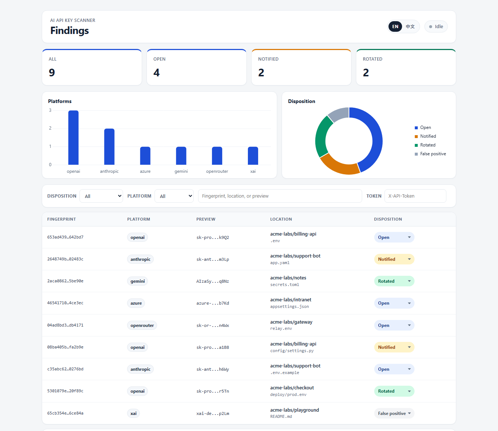

[English](README.md) · **简体中文**

# AI API Key Scanner

在你有权审计的 GitHub 组织、仓库或本地目录里，找出泄露的 API 密钥，配上旁边的接口地址，只在授权目标上核验，扫描结束交出一份脱敏发现记录，交给资产所有方处置。

唯一入口是 `main_v2.2.py`。


<p align="center">
  
</p>

<p align="center">
  <sub>本机面板的英文界面。图中的行是虚构组织 <code>acme-labs</code> 的示例。预览已脱敏。页面上没有完整密钥、余额或价值分。</sub>
</p>

## 一分钟看懂

代码的负责人即使不自己跑命令，也可以按这个顺序读结果。

1. 扫描范围只能是你拥有的，或书面授权你测试的 GitHub 组织、单个 `owner/name` 仓库，或磁盘上的一个目录。
2. 结束后打开 `findings.json`，或本机面板 `http://127.0.0.1:5000`。
3. 每一行是凭据出现过的一个位置。你能看到服务名、一段脱敏预览，以及它来自哪个文件。
4. 通知所有方。通知里只有平台、预览和位置，没有完整密钥。
5. 密钥作废之后，把这一行标成 `rotated`。如果只是占位符或文档示例，标成 `false_positive`。

不打开终端的人也可以看面板。页头有 **EN / 中文**。浏览器语言是中文时默认中文，否则默认英文。地址加上 `?lang=en` 或 `?lang=zh` 可以强制指定。

## 目录

- [一条发现里有什么](#一条发现里有什么)
- [一次扫描怎么走](#一次扫描怎么走)
- [安装](#安装)
- [配置](#配置)
- [运行](#运行)
- [面板](#面板)
- [命令](#命令)
- [通知](#通知)
- [威胁报告](#威胁报告)
- [代理](#代理)
- [识别范围](#识别范围)
- [配置文件](#配置文件)
- [使用边界](#使用边界)
- [代码从哪读](#代码从哪读)
- [更多文档](#更多文档)
- [许可](#许可)

## 一条发现里有什么

交给别人的文件是 `findings.json`，`schema` 为 `findings.v1`。一个对象是凭据的一次出现。`GET /api/findings` 返回同一份数据，这个接口没有 reveal。

| 字段 | 含义 |
| --- | --- |
| `fingerprint` | 密钥的 SHA-256，64 位十六进制。改处置状态时用它当编号。 |
| `platform` | 平台名，例如 `openai`、`anthropic`、`azure`、`openrouter`。 |
| `preview` | 脱敏预览：前 6 个字符、省略号、后 4 个字符。 |
| `repo` | `owner/name`。Gist 为 `gist:用户`。链接解析不出时为空。 |
| `path` | 仓库内路径。链接里没有路径时为空。 |
| `commit` | 从链接里取出的提交或分支名。 |
| `location` | 原始链接或本地路径。 |
| `disposition` | `open`、`notified`、`rotated`、`false_positive`。 |
| `found_time` | 写入数据库的时间。 |

```json
{
  "schema": "findings.v1",
  "generated_at": "2026-11-10T08:00:00Z",
  "findings": [
    {
      "fingerprint": "06f934c99f8f30950ff32100387372c829f385d213587e2ebd710e930992099b",
      "platform": "openai",
      "preview": "sk-pro...k9Q2",
      "repo": "acme-labs/billing-api",
      "path": ".env",
      "commit": "4c1e9a2",
      "location": "https://github.com/acme-labs/billing-api/blob/4c1e9a2/.env",
      "disposition": "open",
      "found_time": "2026-11-10T07:40:00"
    }
  ]
}
```

这里的指纹和预览是说明用的，不是凭据。

| 处置状态 | 含义 | 谁来标 |
| --- | --- | --- |
| `open` | 已入库，还没有人处理。 | 扫描的默认状态。 |
| `notified` | 已配置的通知渠道收下了这条通知。 | 通知发送成功之后，由程序标上。 |
| `rotated` | 密钥已经作废或更换。 | 人来标，用 `--set-disposition` 或面板。 |
| `false_positive` | 示例、占位符，或根本不是秘密。 | 人来标。 |

`findings.json` 和 `dispositions.json` 已在 `.gitignore` 里。不要提交。

## 一次扫描怎么走

1. **搜索。** 远程扫描只有在你传入 `--target-org` 或 `--target-repo` 之后才会向 GitHub 发代码搜索。两个都没有，搜索请求不会出去。`--scan-local` 读磁盘上的目录，包括当前文件和 Git 历史。同一份 Git blob 只解析一次；下一次会跳过已经记在 `scanned_blobs` 里的 blob，数据库里已有的密钥也不会再次送去验证。
2. **配对。** 从命中内容里取出密钥；同一处上下文里有 `base_url` 时，一并绑上。官方地址、Azure 资源和中转站因此是不同的目标。
3. **过滤。** 熵和路径黑名单丢掉明显的样本，例如 `sk-test`、文档占位符和厂商示例文件。
4. **验证。** 只向配对到的地址发请求，并且只针对你有权测试的资产。入库状态是 `pending`、`valid`、`invalid` 或 `quota_exceeded`。`quota_exceeded` 表示凭据有响应，随后碰到额度限制。在授权评估里，它仍然算存活凭据。
5. **入库。** 设置了 `DB_ENCRYPTION_KEY` 之后，`api_key` 列是 Fernet 密文，去重用 SHA-256 的 `key_hash`。没设这把密钥时，扫描拒绝写入，除非显式加上 `--allow-plaintext-db`。这条路径不写余额，也不写 `is_high_value`。
6. **交出。** 扫描结束写出 `findings.json`。

旁边还有两个开关。`AI_FILTER_ENABLED=1` 会加一轮模型判断，去掉更像误报的命中，默认关闭。Gist、Pastebin、GitLab Snippets、Searchcode、GitHub Events 这些不能按组织收窄的公开源，默认关闭，要同时加 `--allow-public-sources`。

验证会拒绝私网、链路本地、保留和多播地址；域名的任一解析结果落在这些范围里，也会拒绝。`base_url` 为空时，走该厂商自己的官方接口。

## 安装

Python 3.10 及以上。

```bash
git clone https://github.com/Coff0xc/Github-API-scan.git
cd Github-API-scan
pip install -r requirements.txt
```

Windows 上如果依赖提到 `uvloop`，跳过它。扫描器不依赖它。

## 配置

令牌不要进仓库。`config_local.py` 已被 gitignore。也可以只用环境变量。

bash：

```bash
export GITHUB_TOKENS="ghp_your_token_here"
export DB_ENCRYPTION_KEY="一段足够长的随机密码"
export DASHBOARD_TOKEN="另一段随机密码"
```

PowerShell：

```powershell
$env:GITHUB_TOKENS = "ghp_your_token_here"
$env:DB_ENCRYPTION_KEY = "一段足够长的随机密码"
$env:DASHBOARD_TOKEN = "另一段随机密码"
```

也可以把 `config_local.py.example` 复制为 `config_local.py`，在里面填写 `GITHUB_TOKENS`。

GitHub 令牌需要能搜索你要审计的那个组织或仓库。经典令牌至少要有读取这些仓库的权限。多个令牌可以分摊搜索额度，用逗号放进 `GITHUB_TOKENS`，或在 `config_local.py` 里写成列表。

`DB_ENCRYPTION_KEY` 负责结果库的静态加密。浏览器里改处置状态需要 `DASHBOARD_TOKEN`。读取脱敏发现列表本身不发送这枚令牌。两把密钥都按密码保管：足够长、随机，并且不要出现在聊天记录和工单里。

## 运行

用 `--authorized` 确认已阅读 [AUTHORIZED_USE.md](AUTHORIZED_USE.md)，或在 CI 里设置 `SCANNER_AUTHORIZED=1`。两个都没有时，交互终端会要求输入 `y`。Docker Compose 不会替你打开这个开关，也不会替你填组织名。

```bash
python main_v2.2.py --authorized --target-org your-org
python main_v2.2.py --authorized --target-repo owner/name
python main_v2.2.py --authorized --scan-local D:\repos\target
```

`--target-repo` 必须是 `owner/name`。两个范围同时给出时，仓库优先。

`--scan-local` 会走工作区和 Git 历史，所以后来提交里删掉的密钥仍可能出现。`--no-git-history` 只看当前文件。

上面的扫描结束时，会在工作目录写出 `findings.json`。也可以指定路径：

```bash
python main_v2.2.py --authorized --target-org your-org --findings-json reports/findings.json
```

只传 `--findings-json`、不给扫描目标时，程序导出已有数据库然后退出。

## 面板

```bash
python web_dashboard.py
```

打开 `http://127.0.0.1:5000`。监听地址默认是 `127.0.0.1`，除非设置了 `DASHBOARD_HOST`。改成其他地址会把面板暴露到网络上，那时必须有足够强的 `DASHBOARD_TOKEN`。

首页就是截图里的发现列表：

- 全部、待处置、已通知、已轮换四个计数。
- 平台分布和处置状态图。
- 按处置、平台筛选，并可以搜索指纹、预览和位置。
- 表格列是指纹、平台、脱敏预览、仓库与路径、处置。
- 页头 **EN / 中文**。选择会记在这台浏览器里。

指纹列显示缩短形式。完整的 64 位十六进制在这一行的悬停提示里，提交时用完整值。

在浏览器里改状态时，把 `DASHBOARD_TOKEN` 填进令牌框。浏览器把它放在 `sessionStorage`，请求时放进 `X-API-Token` 头。请求体只有指纹和新状态。响应回 `ok`、指纹和状态，不回密钥。没带令牌是 HTTP 401。服务端没设令牌时，受保护的调用返回 HTTP 403。令牌错误会被限速，返回 HTTP 429。

`GET /api/findings` 是脱敏列表，不需要令牌。这个页面上没有导出按钮。

数据库默认是 `leaked_keys.db`。扫描器和面板都认 `DB_PATH`。

## 命令

日常会用到的：

```bash
python main_v2.2.py --stats
python main_v2.2.py --findings-json findings.json
python main_v2.2.py --set-disposition <64位十六进制指纹> notified
python main_v2.2.py --set-disposition <64位十六进制指纹> rotated
python main_v2.2.py --apply-dispositions dispositions.json

python main_v2.2.py --export results.txt --status valid
python main_v2.2.py --export-csv results.csv --status valid
python main_v2.2.py --export-encrypted secure.bin

python main_v2.2.py --authorized --report threat.md
```

文本和 CSV 默认脱敏。`--reveal` 会把完整密钥写进导出文件。只在授权评估里使用，并且不要提交这个文件。

| 参数 | 作用 |
| --- | --- |
| `--authorized` | 确认本次运行的使用边界。 |
| `--target-org ORG` | 把 GitHub 搜索限定到一个组织。 |
| `--target-repo OWNER/REPO` | 把 GitHub 搜索限定到一个仓库。 |
| `--scan-local DIR` | 扫描本地目录及其 Git 历史。 |
| `--no-git-history` | 配合 `--scan-local`，跳过历史提交。 |
| `--findings-json FILE` | 写出脱敏发现文件。 |
| `--set-disposition FINGERPRINT STATUS` | 把一行设为 `open`、`notified`、`rotated` 或 `false_positive`。 |
| `--apply-dispositions FILE` | 按指纹批量写回 JSON 里的处置。 |
| `--stats` | 打印数据库计数。 |
| `--export FILE` | 脱敏文本导出。可用 `--status valid` 或 `quota_exceeded` 过滤。 |
| `--export-csv FILE` | 脱敏 CSV 导出。 |
| `--export-encrypted FILE` | Fernet 加密导出，密钥写在旁边的文件里。 |
| `--decrypt FILE` | 解密 `--export-encrypted` 生成的文件。 |
| `--key-file KEY` | `--decrypt` 使用的密钥文件。 |
| `--reveal` | 文本或 CSV 导出时写入完整密钥。 |
| `--report FILE` | 写 Markdown 威胁报告。 |
| `--reveal-report` | 报告里输出完整密钥。 |
| `--db FILE` | 数据库路径，默认 `leaked_keys.db`。 |
| `--proxy URL` | 出站 HTTP 代理。 |
| `--allow-plaintext-db` | 允许在没有 `DB_ENCRYPTION_KEY` 时写入。 |
| `--allow-public-sources` | 允许 Gist、Pastebin、GitLab、Searchcode 和 Events。 |
| `--gist` `--pastebin` `--gitlab` `--searchcode` `--realtime` | 打开其中一种来源。仍然需要 `--allow-public-sources`。 |
| `--all-sources` | 全部打开。仍然需要 `--allow-public-sources`。 |
| `--pastebin-key KEY` | 仅在启用 Pastebin 时使用的 Pro API Key。 |
| `--no-cache` | 这一次不使用验证缓存。 |
| `--no-monitor` | 关闭性能监控。 |
| `--no-dynamic-queue` | 队列大小保持固定。 |

代理写回的处置文件：

```json
{
  "updates": [
    {"fingerprint": "<64位十六进制>", "disposition": "rotated"}
  ]
}
```

也可以是纯数组，或带 `findings` 的对象。多余字段会被忽略。指纹必须是 64 位十六进制，状态必须是上面四个名字之一。

## 通知

配置了渠道之后，`valid` 或 `quota_exceeded` 的结果可以发出一条处置通知：平台、脱敏预览、位置，并写明通知里没有完整密钥、也没有余额。渠道接收成功后，这一行变为 `notified`。

渠道来自 `notify_config.yaml`（或 `NOTIFY_CONFIG`），以及环境变量 `DISCORD_WEBHOOK`、`SLACK_WEBHOOK`、`TELEGRAM_BOT_TOKEN`、`FEISHU_WEBHOOK`、`DINGTALK_WEBHOOK`、`SERVERCHAN_KEY`、`BARK_DEVICE_KEY`。这些都没设时，不会发送，行保持 `open`。需要配置文件时，从 `notify_config.example.yaml` 复制。说明见 [docs/NOTIFY_README.md](docs/NOTIFY_README.md)。

`rotated` 只能人工标记。程序看不到厂商控制台里密钥是否真的已作废。

## 威胁报告

```bash
python main_v2.2.py --authorized --report threat.md
python main_v2.2.py --authorized --scan-local D:\repos\target --report threat.md
```

报告用于授权评估。它把 `valid` 和 `quota_exceeded` 视为存活凭据，默认脱敏。`--reveal-report` 会把完整密钥写进 Markdown。这个文件不要进 git。

## 代理

Grok Bot 和 Muse 只读发现文件，再把处置状态写回来。它们不启动扫描，也不接收明文密钥、`DB_ENCRYPTION_KEY` 或 `DASHBOARD_TOKEN`。约定写在 [docs/AGENT_PIPELINE.md](docs/AGENT_PIPELINE.md)。

## 识别范围

有单独规则的包括：OpenAI、Anthropic、Gemini、Azure OpenAI、xAI、Meta Llama、OpenRouter、Portkey、LiteLLM、Cloudflare AI、AWS Bedrock、Vertex AI、阿里云、火山引擎、腾讯混元、百度千帆、DeepSeek、Moonshot、智谱、Groq、Cohere、Mistral、Hugging Face、Together、Replicate、Perplexity、Fireworks。

没有单独规则的服务仍可能走通用匹配。GitHub 令牌、AWS 密钥和 Stripe 密钥在这组通用范围内。

这里列出平台，只说明扫描器认识它的形状和核验位置。不表示可以对未获授权的仓库去核验。

## 配置文件

后面的来源覆盖前面的：内置默认值，然后是 `config.yaml`，然后是 `config_local.py`，最后是命令行。

`config.yaml` 里的熵阈值、并发、黑名单和批量大小会被读进去。用它调节扫描器的工作强度。秘密放在环境变量或 `config_local.py` 里，不要写进 `config.yaml`。

## 使用边界

允许的是：审计你自己的资产；资产所有方书面授权的评估；你仍能吊销自己凭据时的应急处理；在你控制的实验环境里做检测研究。

不要用它去没有授权的仓库里收集密钥。不要核验别人的密钥。不要使用扫到的密钥，也不要把它传出去。发现泄露后通知所有方，通知里不要贴出秘密。

程序会执行上面的范围检查。完整政策和发现之后怎么做，写在 [AUTHORIZED_USE.md](AUTHORIZED_USE.md)。给这个项目报缺陷时，如何避免贴上密钥、数据库和令牌，写在 [SECURITY.md](SECURITY.md)。

## 代码从哪读

```
main_v2.2.py            唯一入口
scanner.py              搜索，以及密钥和 base_url 的配对
validator_optimized.py  入口使用的验证循环
validator.py            熔断、验证结果、验证请求
findings_feed.py        脱敏发现记录
database.py             SQLite
key_vault.py            结果库加密
threat_report.py        授权评估报告
web_dashboard.py        本机面板
notifier_v2.py          通知渠道
use_boundary.py         启动确认和范围检查
```

## 更多文档

- [AUTHORIZED_USE.md](AUTHORIZED_USE.md)
- [SECURITY.md](SECURITY.md)
- [docs/QUICKSTART.md](docs/QUICKSTART.md)
- [docs/USAGE_GUIDE.md](docs/USAGE_GUIDE.md)
- [docs/LOCAL_SCANNING.md](docs/LOCAL_SCANNING.md)
- [docs/AGENT_PIPELINE.md](docs/AGENT_PIPELINE.md)
- [docs/DOCKER_GUIDE.md](docs/DOCKER_GUIDE.md)
- [docs/NOTIFY_README.md](docs/NOTIFY_README.md)
- [docs/AI_ASSISTED_ANALYSIS.md](docs/AI_ASSISTED_ANALYSIS.md)

## 许可

MIT。见 [LICENSE](LICENSE)。
