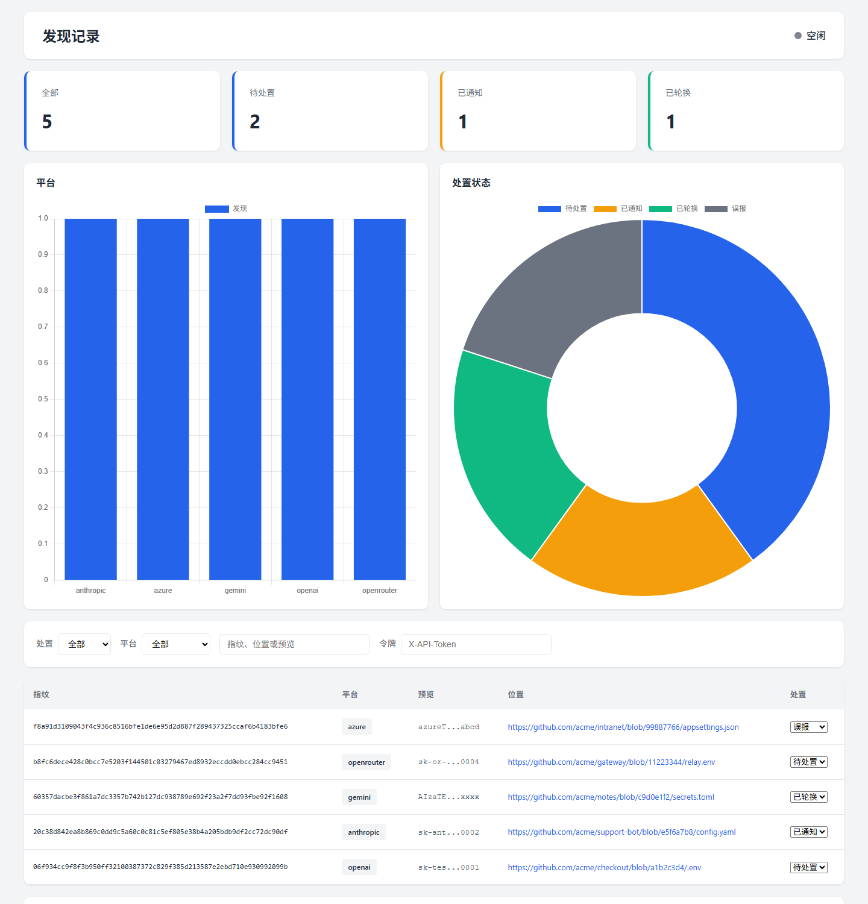

<h1 align="center">AI API Key Scanner</h1>

<p align="center">
<b>找出泄露的 OpenAI / Claude / Gemini / Grok / DeepSeek 密钥。</b><br>
把密钥和旁边的中转地址绑在一起，检查这对组合是否还活着。<br>
完整密钥留在跑扫描的那台机器上。
</p>

<p align="center">
  <a href="https://github.com/Coff0xc/Github-API-scan/stargazers"></a>
  
  
  
  &nbsp;<a href="README.md">English</a>
</p>

<p align="center">
  
</p>

```bash
git clone https://github.com/Coff0xc/Github-API-scan.git
cd Github-API-scan
pip install -r requirements.txt

python main_v2.2.py --authorized --target-org your-org
python main_v2.2.py --authorized --target-repo owner/name
python main_v2.2.py --authorized --scan-local ./your-repo

python web_dashboard.py    # http://127.0.0.1:5000
```

覆盖 50+ 平台（OpenAI、Claude、Gemini、xAI、DeepSeek、OpenRouter、Groq、Azure、Moonshot、智谱等）。文件里写了 `OPENAI_BASE_URL` 一类中转地址时，验证打的是那个地址，不是官方站点。扫完打开本机面板，每行只有平台、脱敏预览和文件位置。

运行前读 [AUTHORIZED_USE.md](AUTHORIZED_USE.md)，用 `--authorized` 确认范围。远程搜索必须带 `--target-org` 或 `--target-repo`。完整说明、字段表、面板接口见 [英文 README](README.md)。

## 三条常用命令

```bash
python main_v2.2.py --authorized --target-org your-org
python web_dashboard.py
python main_v2.2.py --findings-json findings.json
```

`GITHUB_TOKENS`、`DB_ENCRYPTION_KEY`、`DASHBOARD_TOKEN` 用环境变量或 `config_local.py` 配置，不要提交进 git。
